<div align="center">

# Cost-Aware DIP Feature Selection for Brain Tumour Segmentation

**Which hand-crafted image-processing channels are worth giving a U-Net, once you count what they cost?**
A multi-objective search (R²S-NSGA-II) on BraTS 2020 MRI.


-20BEFF?logo=kaggle&logoColor=white)

</div>

---

## Contents

1. [Overview](#overview)
2. [Key results](#key-results)
3. [Pipeline](#pipeline)
4. [Method](#method)
5. [Results in detail](#results-in-detail)
6. [Repository layout](#repository-layout)
7. [Getting started](#getting-started)
8. [Limitations](#limitations)
9. [Ideas for next steps](#ideas-for-next-steps)
10. [Data and acknowledgements](#data-and-acknowledgements)

---

## Overview

Digital image processing (DIP) features such as contrast maps, gradients and texture filters encode knowledge that radiologists use. Feeding them to a segmentation network as extra input channels can help, but each feature costs computing time, and it is not obvious which ones matter.

This project treats that as a **multi-objective feature-selection problem**. For every subset of 15 DIP features, a 2D U-Net is trained and scored on three things at once:

| Objective | Meaning |
| --- | --- |
| **Accuracy** | Clinically weighted region Dice (CWRD) |
| **Boundary quality** | Weighted 95% Hausdorff distance (HD95) |
| **Cost** | Feature-extraction time in ms per slice |

A custom optimiser, **R²S-NSGA-II**, searches the subsets. The selected models are then retrained and tested in 3D on patients that were never used for any choice.

Around the main search, the notebook also studies crop and resize choices, loss functions (BCE, Dice, BCE + Dice), an α-weighted loss with fixed, learned and convex-fusion α, and longer training.

---

## Key results

Final test on **38 unseen patients**, evaluated in 3D at the original 240 × 240 × 155 size (notebook 5, one seed).

| Model | Extra channels | Dice WT / TC / ET | Test CWRD | Mean HD95 WT / TC / ET (mm) | Runtime (s / patient) |
| --- | --- | --- | --- | --- | --- |
| MRI only | none | 0.887 / 0.771 / 0.715 | 0.7775 ± 0.162 | 12.2 / 10.0 / 36.3 | 0.10 |
| MRI + all DIP | all 15 | 0.891 / 0.760 / 0.700 | 0.7687 ± 0.168 | 13.4 / 10.4 / 37.5 | 10.63 |
| R2S-Knee | 4 features | 0.891 / 0.762 / 0.718 | 0.7766 ± 0.165 | 14.0 / 11.2 / 36.2 | 0.33 |
| **R2S-BestDice** | **ENH_T1ce-T1 only** | **0.891 / 0.773 / 0.751** | **0.7935 ± 0.139** | **8.2 / 8.9 / 24.5** | **0.14** |

- **One cheap feature gave the best result.** `ENH_T1ce-T1` (post-contrast T1 minus T1) costs 0.32 ms per slice and raised ET Dice from 0.715 to 0.751.
- **More features did not help.** Using all 15 cost about 78.5 ms per slice (10.6 s per patient) and scored lower than MRI only.
- **The gain is not statistically significant.** The CWRD difference over MRI only is +0.016 (paired Wilcoxon, p = 0.09, 38 patients), so treat it as a promising signal, not a proven effect.
- **The model is tiny.** The U-Net has 1,942,755 parameters (1,942,899 with the extra channel) and trains for 30 epochs in a few minutes.

> HD95 values are means over patients. A patient with an empty prediction or an empty label receives a fixed penalty of 373.13 mm, which inflates the ET mean.

---

## Pipeline

```mermaid
flowchart LR
    A[BraTS 2020<br/>150 of 369 patients] --> B[Preprocessing<br/>crop 192, resize 128,<br/>z-score per channel]
    B --> C[Slice cache<br/>32 slices per patient]
    C --> D[DIP feature bank<br/>15 feature maps]
    D --> E[Feature analysis<br/>cost, AUC relevance,<br/>redundancy]
    E --> F[R2S-NSGA-II search<br/>6-epoch proxy training]
    F --> G[Pareto set<br/>3 objectives]
    G --> H[Final training<br/>30 epochs]
    H --> I[3D test<br/>38 unseen patients]
    I --> J[Statistics and<br/>paper outputs]
```



---

## Method

### Data and set-up

| Item | Setting |
| --- | --- |
| Patients | 150 of the 369 labelled BraTS 2020 patients |
| Split | 90 train / 22 validation / 38 test, at patient level, seed 42 |
| Slices | 32 per train or validation patient, 75% containing tumour (3,584 in total) |
| Pre-processing | z-score per patient and channel inside the brain, percentile clipping, centre crop 192, resize to 128 × 128 (1.5 mm per pixel) |
| Regions | WT = labels 1, 2, 4; TC = labels 1, 4; ET = label 4 |
| Network | 2D U-Net, base 16 channels, 5 levels, BatchNorm |
| Training | AdamW (lr 2e-3, weight decay 1e-4), OneCycle schedule, batch 32, mixed precision, flips; loss = BCE + soft Dice |
| Proxy / final epochs | 6 inside the optimiser, 30 for the selected models |

### Metrics

```math
CWRD = 0.25\,Dice_{WT} + 0.35\,Dice_{TC} + 0.40\,Dice_{ET}
```

The search minimises three objectives for a feature subset (g<sub>k</sub> = 1 when feature k is used, c<sub>k</sub> = its cost in ms per slice):

```math
f_1 = 1 - CWRD, \qquad f_2 = \sum_r w_r\,HD95_r, \qquad f_3 = \sum_k g_k\,c_k
```

### The DIP feature bank

| Group | Feature | Cost (ms / slice) |
| --- | --- | --- |
| Contrast | CLAHE_FLAIR | 4.52 |
| Contrast | BILAT_T1ce | 0.56 |
| Contrast | HYPER_FLAIR | 0.44 |
| Cross-modal | **ENH_T1ce-T1** | **0.32** |
| Cross-modal | FLAIR-T2 | 0.30 |
| Cross-modal | ASYM_FLAIR | 0.41 |
| Edge | GRAD_FLAIR | 0.76 |
| Edge | GRAD_T1ce | 0.57 |
| Edge | DoG_FLAIR | 0.82 |
| Blob / morphology | LoG_T1ce | 0.89 |
| Blob / morphology | TOPHAT_T1ce | 0.39 |
| Texture | ENTROPY_T1ce | 12.12 |
| Texture | LSTD_FLAIR | 0.40 |
| Texture | GABOR_T2 | 52.30 |
| Texture | LBP_T1ce | 3.76 |

All 15 together cost about 78.5 ms per slice. Texture features are the most expensive and the least relevant by AUC.

### R²S-NSGA-II

A standard NSGA-II baseline is extended with three ideas.

| Part | What it does |
| --- | --- |
| **R1: relevance guidance** | Each feature gets a prior selection probability, built from its clinically weighted AUC, its novelty against the raw MRI channels, and its cost. The prior drives initialisation and mutation. |
| **R2: redundancy repair** | A feature that is a near-copy of a raw MRI channel (\|r\| > 0.95) is never kept. For a pair with \|r\| > 0.70, only the one with the higher prior is kept. |
| **S: surrogate pre-screening** | A ridge regression predicts accuracy and boundary quality from the genome. Four times as many offspring as needed are generated, and only the most promising are actually trained (20% of slots stay random). |

Search quality is compared by exact 3-objective **hypervolume**, with a budget of population 10 and 6 generations (70 unique evaluations per run).

---

## Results in detail

### Optimiser comparison (one seed, 70 evaluations each)

| Method | Best proxy CWRD | Best wHD95 (mm) | Hypervolume | Pareto size |
| --- | --- | --- | --- | --- |
| **R²S-NSGA-II** | 0.8110 | 45.33 | 1.2767 | 7 |
| NSGA-II | 0.8063 | 46.30 | 1.1518 | 5 |

Every solution on the R²S Pareto front uses at most four cheap features (under 1.7 ms per slice) and none uses a texture feature. In a component ablation the surrogate (S) gave the clearest benefit; removing relevance guidance (R1) did not lower hypervolume in this single run.

### Feature-group ablation (proxy CWRD change, one run each)

| Group | Added to MRI only | Removed from all 15 |
| --- | --- | --- |
| Contrast | +0.0141 | −0.0091 |
| Cross-modal | +0.0083 | −0.0051 |
| Edge | +0.0001 | −0.0096 |
| Blob / morphology | +0.0071 | −0.0165 |
| Texture | −0.0126 | −0.0131 |

The proxy noise is about ±0.0058 (twice the standard deviation of 0.0029).

### Side studies

| Study | Finding |
| --- | --- |
| Loss function (test CWRD) | BCE 0.779, Dice 0.781, **BCE + Dice 0.792**; no difference significant after Holm correction |
| α-weighted loss | Validation picked α = 0.9; test was best at α = 0.5 (CWRD 0.804); learned α drifted toward 1 and fusion gave α* ≈ 0.8; no method significantly better than α = 0.5 |
| Resolution (validation CWRD) | resized 128: 0.8379, crop 192: **0.8483**, native 240: 0.8456 at 2.9× the epoch time |
| Training length (validation CWRD, best epoch) | 30 epochs 0.8309, 60 epochs 0.8321, **100 epochs 0.8419** |

---

## Repository layout

| Path | Description |
| --- | --- |
| `dip-brain-tumour__5_.ipynb` | The fuller, later notebook: all phases through final test and paper outputs |
| `dip-brain-tumour__3_.ipynb` | An earlier state of the same project (stops before the final phases) |
| `brats_cache/` | Created at run time: patient split and cached slices |
| `results/` | Created at run time: saved results |
| `figures/` | Created at run time: saved figures |
| `checkpoints/` | Created at run time: trained model weights |

The two notebooks differ in places because cells were re-run, so quote numbers from one notebook only. This README uses notebook 5.

---

## Getting started

**Requirements.** A GPU is needed (the project was run on a Kaggle **T4**). The notebook imports:

`torch`, `numpy`, `pandas`, `scipy`, `scikit-learn`, `scikit-image`, `opencv-python`, `nibabel`, `joblib`, `matplotlib`

**Run on Kaggle (the intended route).**

1. Create a Kaggle notebook and upload `dip-brain-tumour__5_.ipynb`.
2. Attach the BraTS 2020 training data as an input dataset.
3. Turn on a GPU (T4).
4. Run the cells from top to bottom.

**Run elsewhere.** Set two environment variables before starting: `BRATS_INPUT` (folder holding the BraTS data) and `WORK_DIR` (where caches, results, figures and checkpoints are written).

**Quick test.** In the first cell, set `QUICK_RUN = True` for a tiny end-to-end smoke test (about 10 to 20 minutes). Leave it `False` for the full experiment.

**Main settings** live in the `CFG` block of the first cell: number of patients, crop and resize, epochs, optimiser budget, region weights and the R²S thresholds. The optimiser runs with one seed by default; the notebook suggests `opt_seeds=(0, 1, 2)` for a paper.

---

## Limitations

These are stated plainly so results are read with the right weight.

- **Not significant.** The best gain over MRI only has p = 0.09 on 38 test patients.
- **One seed.** Each model was trained once, and the optimiser ran with one seed. Retraining the same MRI-only model gave test CWRD of 0.792 in one run and 0.7775 in another.
- **Subset of the data.** 150 of 369 patients, and only 90 for training.
- **2D and resized.** Slices are trained at 128 × 128 (1.5 mm per pixel), with no 3D context.
- **Short training.** 30 epochs. A 100-epoch run improved validation CWRD by about 0.011.
- **Proxy noise.** The 6-epoch proxy has a seed noise of about 0.003 to 0.004, which is not small next to some differences between feature subsets.
- **Boundary means.** HD95 means are inflated by the 373 mm penalty for empty masks.
- **All four MRI scans needed.** Missing-modality behaviour was not tested, and the best feature needs both T1ce and T1.
- **Indirect comparison with papers.** Other studies use different splits and BraTS versions, and their models were not retrained here.

---

## Ideas for next steps

These are proposals, not completed work.

- [ ] Use all 369 patients, or cross-validation
- [ ] Add 3D context (neighbouring slices as channels, or a small 3D U-Net on patches)
- [ ] Larger input (crop 192) and longer training
- [ ] More augmentation, and test-time flip averaging
- [ ] Small-region clean-up for ET, with thresholds chosen on validation only
- [ ] Run 3 seeds for mean ± SD, and finish the random-search baseline
- [ ] Report FLOPs and test on the official BraTS 2020 validation server

---

## Data and acknowledgements

The data are from the Multimodal Brain Tumor Segmentation Challenge (**BraTS 2020**). They are not included in this repository; obtain them from the challenge organisers and follow their terms of use.

**Author:** Anshika
